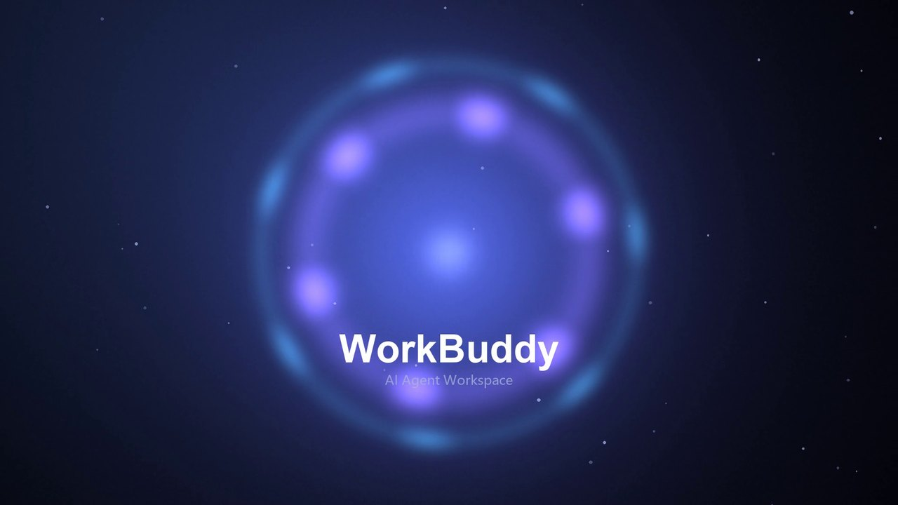

# WorkBuddy Anime Boot

> 🆕 **v1.1.0 · 新增「莱茵开屏」舞台**（[`rhine-boot/`](rhine-boot/)）——
> 不改 asar、不重打包，往 `renderer/index.html` 注入 ~2.8KB 接管逻辑，
> 把 134KB 开屏载荷当**外挂脚本**加载，播完再放行 React。真机 5.8.3 已跑通。
> 想看实现路径 / 已知卡顿 / 参考来源，直接读 [`rhine-boot/README.md`](rhine-boot/README.md)。

> 给 WorkBuddy 桌面端换上 **动漫启动动画 + 全屏壁纸背景 + 深色玻璃面板**
> 一键安装 · 更新自动还原 · 一键卸载

> 🤖 **把这行丢给 AI 就行**：`帮我装这个项目：https://github.com/lenyvZWY/workbuddy-anime-boot`
> —— 它会读下面的说明，自己下载、定位安装目录、装好。完整指令见 [docs/PROMPT.md](docs/PROMPT.md)




## ✨ 特性

| 效果 | 说明 |
| --- | --- |
| 🎬 **启动动画** | 打开 WorkBuddy 时播放全屏动画，播完无缝进入主界面（点击 / Esc 可跳过） |
| 🧪 **莱茵开屏**（v1.1.0） | 另一套启动画面：`rhine-boot/`，外挂脚本加载，三舞台可切（splash / video / 550c） |
| 🌌 **全屏壁纸** | 整个界面透出你的壁纸 —— 包括会话列表、任务列表、侧栏 |
| 🪟 **深色玻璃** | 面板自动变半透明深色磨砂，字迹清晰；下拉菜单保持不透明可读 |
| 🔄 **更新自愈** | WorkBuddy 自动更新冲掉皮肤后，看护在 3 分钟内自动装回来 |
| 🧯 **安全兜底** | 三重校验防白屏 · 原文件自动备份 · 一键卸载还原 |
| 🎨 **零依赖** | 只用 Windows 自带 PowerShell，无需安装任何环境 |

## 🚀 快速开始

**前置要求**：Windows 10/11 + 已安装 [WorkBuddy](https://www.workbuddy.cn) 桌面端。

```text
1. 下载本仓库（Code → Download ZIP，或 git clone）
2. 双击  install.cmd        ← 就这一下
3. 重启 WorkBuddy，享受 ✨
```

安装器会自动完成：定位安装目录 → 读取版本要求 → 实时构建 → 三重校验 → 备份 → 写入 → 部署素材 → 安装更新看护。

> 🤖 **让 AI 装（无图形界面 / 命令行）**：
> `powershell -NoProfile -ExecutionPolicy Bypass -File install.ps1 -AppPath "<WorkBuddy安装目录>"`

> 💡 安装器**不会**新建安装目录里的任何文件夹（只写 3 个文件），不会影响 WorkBuddy 官方更新。
> 如果你的 WorkBuddy 装在特殊位置，可以拖文件夹到 `install.cmd` 上，或用命令行：`install.cmd -AppPath "D:\你的路径\WorkBuddy"`。

## 🎨 换成你自己的素材

替换 `media/` 目录下的文件，然后重新运行安装器（先 `uninstall.cmd` 再 `install.cmd`）：

| 文件 | 用途 | 建议 |
| --- | --- | --- |
| `media/boot.mp4` | 启动动画 | 1920×1080（或同比例），H.264 编码；长度随意（6~20 秒最佳） |
| `media/wallpaper.jpg` | 界面壁纸 | 1920×1080 以上，**建议偏暗**（浅色图会压不住，字看不清） |

- **只要壁纸不要动画** → 删掉 `boot.mp4`
- **只要动画不要壁纸** → 删掉 `wallpaper.jpg`
- **想生成默认风格的素材** → `python extra/gen_media.py`（需要 pillow / numpy / imageio-ffmpeg）
- **用喜欢的视频当动画** → 用 ffmpeg 转一下：`ffmpeg -i 原视频.mp4 -c:v libx264 -pix_fmt yuv420p -movflags +faststart media/boot.mp4`

> ⚠️ 素材版权请自行把关，不要直接使用影视 / 游戏片段进行传播。

## 🔄 更新自愈（看护）

`install.cmd` 默认会安装"更新看护"（一个开机自启的轻量后台脚本，每 3 分钟空转检查一次）：

```text
WorkBuddy 自动更新 → 皮肤被官方文件覆盖
        ↓
看护检测到（3 分钟内）→ 自动把皮肤装回 → 重启 WorkBuddy 即恢复
```

**安全设计**：如果新版本改了界面结构（index.html 字节数变化），看护会**拒绝操作**并写日志，而不是盲目覆盖导致白屏 —— 这时请来 Issues 反馈，我会为新版本适配。

不想用看护？运行 `tools\remove-autostart.cmd` 一键移除（皮肤不受影响）。

## 🗑️ 卸载还原

双击 `uninstall.cmd` —— 还原原版界面 + 删除素材 + 移除看护。
原始文件备份保留在 `%USERPROFILE%\.workbuddy-anime\backup\`，随时可以再装回来。

## ⚙️ 工作原理（一句话版）

WorkBuddy 是 Electron 应用，"启动时的进入界面"是一个叫**骨架屏**的 HTML 页面：
`<安装目录>\resources\app.asar.unpacked\renderer\index.html`

本项目在这个文件里注入启动动画、壁纸和深色玻璃样式 —— 直接改文件，不打包、不打补丁、不碰主程序。

⚠️ 但有个**致命细节**：这个文件的字节数必须和 `app.asar` 头部记录的完全一致，否则整个界面白屏（Electron 会静默截断读取）。所有细节和踩坑记录都写在这里：

👉 **[docs/HOW-IT-WORKS.md](docs/HOW-IT-WORKS.md)** —— 想改代码 / 二创的必读
👉 **[docs/CUSTOMIZE.md](docs/CUSTOMIZE.md)** —— 配色、透明度、时长等进阶自定义
👉 **[docs/PROMPT.md](docs/PROMPT.md)** —— **懒得动手？复制这段提示词，让你的 AI 自己去 GitHub 下载装好** 🤖

## ❓ FAQ

**Q: 安全吗？会不会影响账号？**
A: 只修改本地界面文件，不联网、不碰账号、不上传数据。风险仅限于"界面本身"（这也是为什么做了三重校验和备份）。

**Q: 更新后皮肤没了？**
A: 装了看护会自动回来（最多 3 分钟 + 重启 WorkBuddy）。没装看护的话重新双击 `install.cmd` 即可。

**Q: 界面白屏了怎么办？**
A: 双击 `uninstall.cmd` 还原，或重装官方版本。安装器有字节数/结构/标记三重校验，正常情况下不会发生。

**Q: 提示"检测到应用安装目录下存在用户项目目录，无法更新"？**
A: 说明安装目录里被放了**额外的文件夹**。本项目只写 3 个文件、不建任何文件夹，不会触发这个问题。

**Q: 支持 macOS 吗？**
A: 目前只支持 Windows（安装器基于 PowerShell）。macOS 版理论上机制相同（Electron app.asar 结构一致），欢迎 PR。

**Q: 可以让启动动画随机播放多个视频吗？**
A: 当前一版一视频。想的话可以改造 `src/boot.js`（有完整注释），欢迎提 PR。

## 📄 License

[MIT](LICENSE) · 仅供学习与个人美化使用，与 WorkBuddy 官方无关。

## 参考与致谢

- 莱茵开屏舞台的视觉与 4.5s 时间轴来自 **`dsh-rhine-splash`**（**DeepSeek Harness / dsh 插件生态**开源插件，MIT © 2026 **ArtemisFowl**），
  本仓库只做 WorkBuddy 侧的外挂注入与放行适配。
- 550C 备选舞台来自 **`yannicksong0106/dsh-550c-boot`**（MIT，同属 DeepSeek Harness 生态），字形原作者 `Voidpocket/html_550c`。
- 与 WorkBuddy 官方无关；素材仅限个人本地美化。
